# Arduino-Uno-Q-Autonomous-Obstacle-Avoidance-Mapping-Rover

This project is meant to serve two purposes:

1.  Continuation of my robotics journey that minimizes sensors needed for obstacle avoidance, skimpily obstacle avoidance algorithm, and add support for SLAM.
2. Maximize the use of the Arduino Uno Q to use both the MCU and MPU based on several things with documented on the Arduino Uno Q forum:
- [Anyone had luck reading from a gamepad? UNO Family / UNO Q Arduino Forum](https://forum.arduino.cc/t/anyone-had-luck-reading-from-a-gamepad/1436918) – custom brick for PS4/Xbox joysticks
- [Getting a Neato XV-11 Lidar Working on the Q UNO Family / UNO Q Arduino Forum](https://forum.arduino.cc/t/getting-a-neato-xv-11-lidar-working-on-the-q/1445568)
- [Substitute for k_thread_define when creating threads UNO Family / UNO Q Arduino Forum](https://forum.arduino.cc/t/substitute-for-k-thread-define-when-creating-threads/1452414)
- [Bridge call or notify and Threading UNO Family / UNO Q Arduino Forum](https://forum.arduino.cc/t/bridge-call-or-notify-and-threading/1451225/6)

**HARDWARE** **– Parts List**

| Item | Image | Link                                                                                                                                                                                                                                                                                                                                                                                                                                                                                                                                                                                                                                                                                                                                             |
| :--- | :---- | :----------------------------------------------------------------------------------------------------------------------------------------------------------------------------------------------------------------------------------------------------------------------------------------------------------------------------------------------------------------------------------------------------------------------------------------------------------------------------------------------------------------------------------------------------------------------------------------------------------------------------------------------------------------------------------------------------------------------------------------------- |
| 1    |   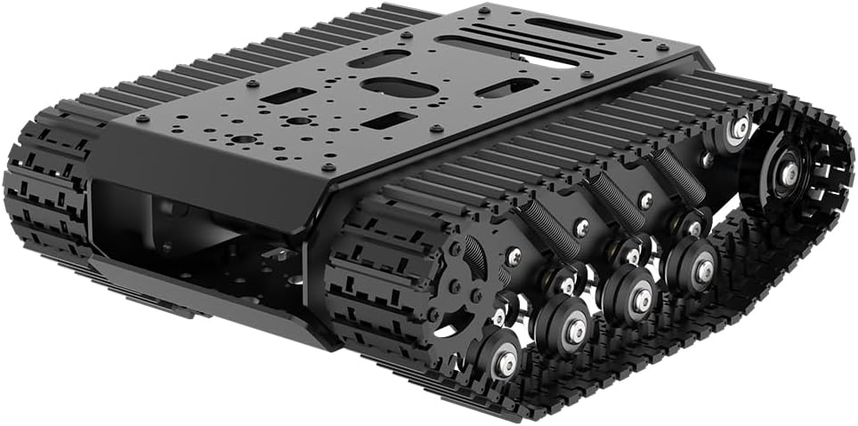    | [Amazon.com: Robot Tracked Tank Car Chassis with Encoder DC Motor, Suspension Shock Absorption Chassis Car Full-Metal Robotic Moving Platform Track for Arduion RPi Microb Jetson Python DIY Smart Robot Maker : Industrial & Scientific](https://www.amazon.com/dp/B0CPJFY3BS?ref_=ppx_hzsearch_conn_dt_b_fed_asin_title_1&th=1)                                                                                                                                                                                                                                                                                                                                                                                                                |
| 2    |       | [Screw Terminal Block Breakout Shield Module for Arduino UNO R3: Amazon.com: Industrial & Scientific ](https://www.amazon.com/dp/B08LH5TCM5?ref_=ppx_hzsearch_conn_dt_b_fed_asin_title_77)                                                                                                                                                                                                                                                                                                                                                                                                                                                                                                                                                       |
| 3    |   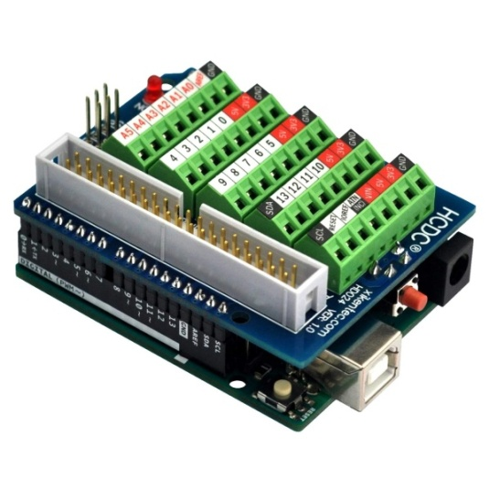     | [Amazon.com: Arduino Motor Shield REV3 [A000079] - Motor Control, 4 DC Motors, 2 Stepper Motors, 1.2A per Motor, Integrated Power Supply, Compatible with Arduino IDE for Robotics and Automation Projects : Electronics](https://www.amazon.com/Arduino-A000079-Motor-Shield-12V/dp/B0084ZQF3O/ref=sr_1_1?crid=XJQRNPCAVYQ9&dib=eyJ2IjoiMSJ9.8-4UuboGx363PCiFqpqQLD1Hd9Q__KQPOr39CWg2lZAhC-0bLX-ZdPHapq9uhi0K9HzHrAwLf-HZDEwcFClbhS0K3ugk6YQDukwLTSmr1oA9SkmDy4DsgNd7vbWYXkK0P6DBHM4Rd2GQHTTTVu9McHiC5ogFqYQKVpgPtJ7UW6X7udCL9FdyExWgGTsf91uvt8GWMZB4ohr-weCbqTex7bM17c_V_FJt2eggVfwG3Ls.kMdslqvOmtzBqSVxOM-B5FydZhbicXg3S8tHbnIBodc&dib_tag=se&keywords=arduino+motor+shield+rev3&qid=1792509400&sprefix=arduino+motor+shi%2Caps%2C148&sr=8-1) |
| 4    |    | [Adafruit 9-DOF Absolute Orientation IMU Fusion Breakout - BNO055 [STEMMA QT / Qwiic] : Adafruit Industries, Unique & fun DIY electronics and kits](https://www.adafruit.com/product/4646)                                                                                                                                                                                                                                                                                                                                                                                                                                                                                                                                                       |
| 5    |       | [SparkFun Qwiic ToF Imager - VL53L5CX - SparkFun Electronics](https://www.sparkfun.com/sparkfun-qwiic-tof-imager-vl53l5cx.html)                                                                                                                                                                                                                                                                                                                                                                                                                                                                                                                                                                                                                  |
| 6    |       | [Amazon.com: 2Pairs Deans-T Plug to 2-PIN JST-PH2.0 Male Female Adapter Conversion Cable/Lead/Wire 22AWG 100mm for ESC 1/24 1/18 RC Crawler SCX24 AX24 TRX4M FCX24 : Toys & Games  ](https://www.amazon.com/dp/B0F322H2ZY?ref_=ppx_hzsearch_conn_dt_b_fed_asin_title_2)                                                                                                                                                                                                                                                                                                                                                                                                                                                                          |
| 7    |       | [ Amazon.com: 10Pair JST-PH 2.0mm 6Pins Connector, Male and Female Plug Jack Cable Connector 2.0mm Pitch 26AWG Cables 20CM : Electronics   ](https://www.amazon.com/dp/B0F322H2ZY?ref_=ppx_hzsearch_conn_dt_b_fed_asin_title_2)                                                                                                                                                                                                                                                                                                                                                                                                                                                                                                                  |
| 8    |       | [Amazon.com: Raogoodcx 360pcs M2 M3 M4 Male Female Nylon Hex Spacer Standoff Screw Nut Assortment Kit : Industrial & Scientific](https://www.amazon.com/dp/B01H03WWD2?ref_=ppx_hzsearch_conn_dt_b_fed_asin_title_1)                                                                                                                                                                                                                                                                                                                                                                                                                                                                                                                              |
| 9    |       | [Amazon.com: I2C Qwiic Cable Kit Stemma QT Wire for SparkFun Development Boards Sensor Board Breakout Breadboard 4 Pin Sh1.0 Connector : Industrial & Scientific ](https://www.amazon.com/dp/B08HQ1VSVL?ref_=ppx_hzsearch_conn_dt_b_fed_asin_title_14)                                                                                                                                                                                                                                                                                                                                                                                                                                                                                           |
| 10   |       | [SparkFun Qwiic Adapter - SparkFun Electronics](https://www.sparkfun.com/sparkfun-qwiic-adapter.html)                                                                                                                                                                                                                                                                                                                                                                                                                                                                                                                                                                                                                                            |
| 11   |       | [Amazon.com: 6 inch Short Fast Charging Cord, 5 Pack Durable USB A to USB Type C 3A Cable for Charging Station Compatible with Samsung Galaxy Note 9 10 S10 S20 S30 OnePlus 7T 8T LG V30 V40 : Electronics  ](https://www.amazon.com/dp/B08LL1SVZD?ref_=ppx_hzsearch_conn_dt_b_fed_asin_title_1&th=1)                                                                                                                                                                                                                                                                                                                                                                                                                                            |
| 12   |       | [Amazon.com: OVONIC 3S 11.1V Lipo Battery 2200mAh 35C Max to 70C Deans Connector - 2 Pack 3S Short Packs Batteries with Hyper Power for RC Car Vehicles RC Boat Drone Airplane Quadcopter Helicopter FPV (2 Packs) : Toys & Games](https://www.amazon.com/dp/B08R6V9FGW?ref_=ppx_hzsearch_conn_dt_b_fed_asin_title_4)                                                                                                                                                                                                                                                                                                                                                                                                                            |
| 13   |       | [Amazon.com: MRBIU 5v 2a Heated Vest Battery Pack, 10000mah LCD Display Power Bank for Heated Jacket,Heated Coat,Heated Clothing,Heated Pant,Heated Hoodie,USB Heated Blanket,Heated Seat/Chair. : Cell Phones & Accessories](https://www.amazon.com/dp/B08YNQPKFJ?ref_=ppx_hzsearch_conn_dt_b_fed_asin_title_1)                                                                                                                                                                                                                                                                                                                                                                                                                                 |
| 14   |       | [Amazon.com: Lswteiz 4Pack White ABS Plastic Sheet 12" x 16" x 1/8" Thick White Rigid Thermoplastic Sheet (Upgrade Surface) 3MM Flexible High Tensile ABS Moldable Plastic Panel for Crafts, DIY, Signs : Industrial & Scientific](https://www.amazon.com/dp/B0GK1Q6QK5?ref_=ppx_hzsearch_conn_dt_b_fed_asin_title_3)                                                                                                                                                                                                                                                                                                                                                                                                                            |
| 15   |       | [Amazon.com: 1110PCS Nuts and Bolts Assortment Kit, Stainless Steel Hardware Assortment Kit with Assorted Screws, Nuts, Bolts and Washers（#4-40#6-32#8-32#10-24） : Industrial & Scientific ](https://www.amazon.com/dp/B0C5N5VSJ2?ref_=ppx_hzsearch_conn_dt_b_fed_asin_title_12)                                                                                                                                                                                                                                                                                                                                                                                                                                                                 |
| 16   |       | [Amazon.com: Honbay CNC Aluminum GPS Folding Antenna Base Mount Holder Bracket for DJI Quadcopter Multicopter (Black) : Toys & Game](https://www.amazon.com/dp/B07WPCY7K5?ref_=ppx_hzsearch_conn_dt_b_fed_asin_title_1)s                                                                                                                                                                                                                                                                                                                                                                                                                                                                                                                         |
| 17   |       | [Amazon.com: 3DR 500MW Radio Telemetry Kit 915Mhz 915 Kit Air and Groud Data Transmit Module for APM2.6 APM2.8 PX4 Pixhawk : Toys & Games ](https://www.amazon.com/Soulload-Telemetry-915Mhz-Transmit-Pixhawk/dp/B0768WQ989/ref=sr_1_1?crid=EWVINNVSWAE0&dib=eyJ2IjoiMSJ9.36pUdBxc2OUuRT8z1d-z98BdINikfFt_Rl9lwPVTthjgC_L__eSpDWTD1ZFuiHFtQQuaxMUF8Vw_Z20SU1bPkQAA-j-HPxIlzJtSkIb7UBlZdb-LADqp8vMCSRT8E_CDnui9dvIJXCWgSWYrkl0fxzOg4IkdMaFpTnJ1A8Ok111ZyUUaASgav00U9vSHdsimlf5UXbcD5V5RZg_A1AtqALeASSv1Z7Lniy3bYkf7HAtUap5JQ-Ml8hRLr6ZWi4x37YnpPE0n1Xk4Z7ebZChRy8aMePTvVA3bQu5wYEkgSmw.6Ij0jjNLmJHGn3ny4IAxJJLoG-fZX018qtv34pVqJtk&dib_tag=se&keywords=3dr+915mhz+telemetry+radio&qid=1792513603&sprefix=3dr+radio%2Caps%2C134&sr=8-1)            |
| 18   |       | XV-11 Neato Lidar plus GetSurreal controller and mount.  Getsurreal is now defunct so the closet thing you are going to get is RPILIdar but you will probably have to modify the code base to get it working correctly.                                                                                                                                                                                                                                                                                                                                                                                                                                                                                                                          |


## **ASSEMBLY**

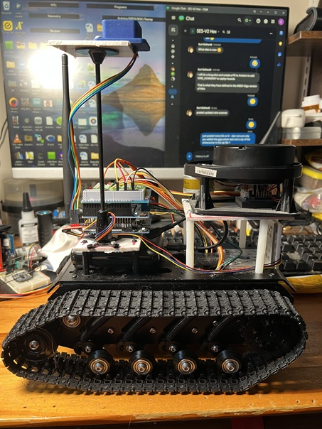 
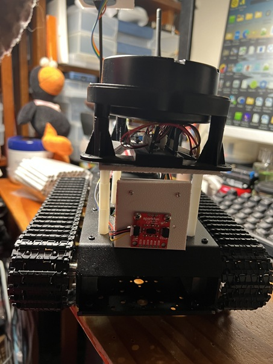 

**BUILD COMMENTS:**

1.  The battery (12) has a Deans-T connector so I used the Deans-T Plug to 2-PIN JST-PH2.0 (6) to the motor shield where I used a female jst to connect to the jst cable I used with the battery.  I cut the other end off and attached it to the Motore Shield

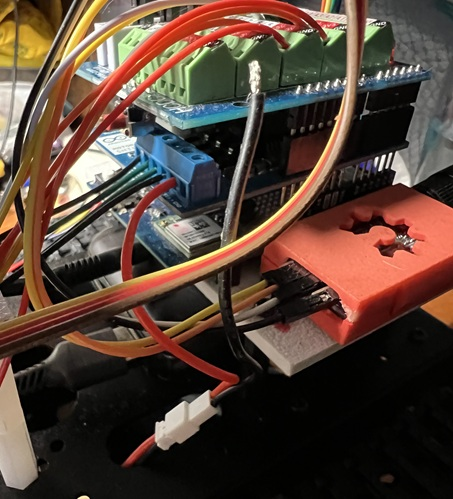 

3. On the motor shield I cut the Vin trace so the battery (12) doesn’t supply power to the Arduino Uno Q
   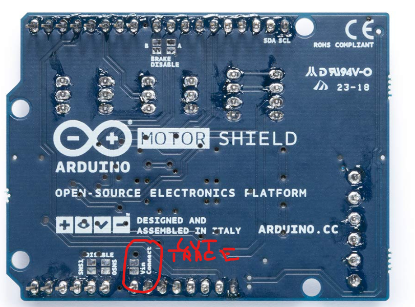 

4. The chassis comes with wiring for the Motors that have a 6 pin jstconnector on them. I used the 6 pin cables (7) to connector from the motor wiring to extend them and attach them to the terminal shield.
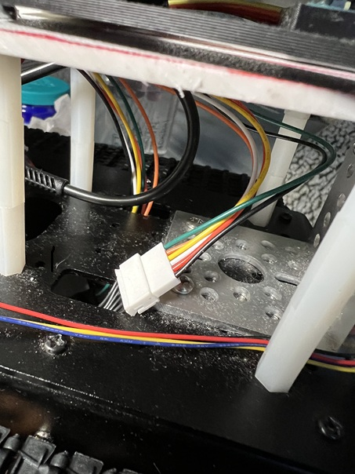 

**Wire Color Coding and Pin Connection**
  
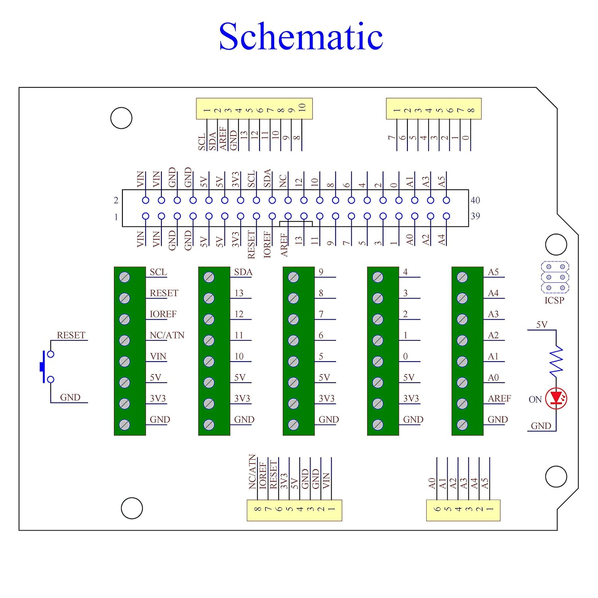 
Figure  Terminal Shield

 
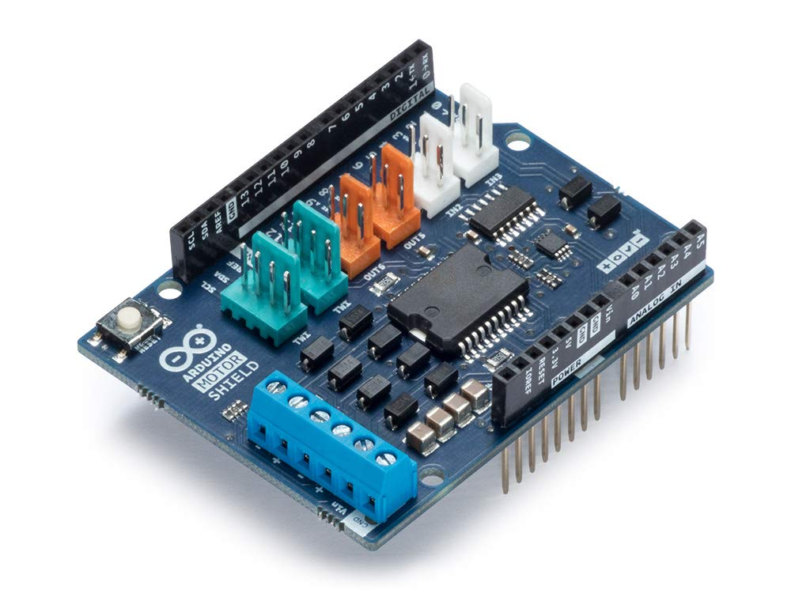 
Figure  Motor Shield


| **Motor** | **Color** | **Function** | **Pin**                       |
| :-------- | :-------- | :----------- | :---------------------------- |
| Left      | Black     | M+           | Motor Shield Pin 1            |
|           | Greeb     | M-           | Motor Shield Pin 2            |
|           | Red       | Gnd          | Encoder Gnd                   |
|           | Orange    | 3.3v         | Encoder Pwr                   |
|           | White     | 2            | Encoder                       |
|           | Yellow    | 4            | Encorder                      |
| Right     | Black     | M+           | Motor Shield Pin 3            |
|           | Green     | M-           | Motor Shield Pin 4            |
|           | Red       | Gnd          | Encoder Gnd – Terminal Shield |
|           | Orange    | 3.3v         | Encoder Pwr – Terminal Shield |
|           | White     | 6            | Encoder – Terminal Shield     |
|           | Yellow    | 7            | Encorder – Terminal Shield    |


**4 LIDAR Connections**

| **Color** | **Function** | **Pin**                               |
| :-------- | :----------- | :------------------------------------ |
| Red       | PWR          | 5v pin on the terminal shiled header  |
| Brown     | GND          | GND pin on the terminal shield header |
| Orange    | 5            | PWM pin on the terminal shield header |
| Yellow    | Serial3      | SDA Pin on the terminal shield header |

**5. 3dr Radio**

| **Color** | **Function** | **Pin**                               |
| :-------- | :----------- | :------------------------------------ |
| White     | PWR          | 5v pin on the terminal shiled header  |
| Black     | GND          | GND pin on the terminal shield header |
| Orange    | 1            | RX on terminal shield                 |
| Yellow    | 0            | TX on terminal shield                 |

**6. BNO055 IMU and VL53 on Wire1**
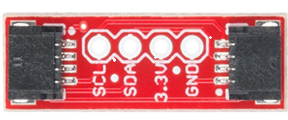 

| **Device** | **Color**         | **Function** | **Pin**                                      |
| :--------- | :---------------- | :----------- | :------------------------------------------- |
| BNO055     | Orange            | 3.3V         | 3.3v pin                                     |
|            | Blue              | GND          | GND pin                                      |
|            | Green             | SDA          | SDA PIN on Adapter                           |
|            | Yellow            | SCL          | SCL Pin on Adapter                           |
| VL53L05CX  | Long Qwiic Cable  | Wire1        | Cable from Device to QWIIC Adapter           |
| Adapter    | Short QWIIC Cable | Wire1        | Short QWIIC cable from Adapter to Wire1 on Q |

7.	The abs is used to create mounting plates for the Q/3dr Radio/ VL53/Lidar.  Cut to size you want to use to mount your hardware.

   ---

   
# **README — Autonomous + Manual Robot Control System (Arduino UNO Q + Zephyr + Linux Bridge)**

## **Overview**
This project implements a hybrid **manual + autonomous robot control stack** running on the **Arduino UNO Q** with Zephyr RTOS and Linux-side coordination via **Arduino RouterBridge**.  
The system integrates:

- **BNO055 IMU** (quaternion → ZYX Euler → declination → heading normalization)
- **Wheel encoders** for odometry
- **VL53L5CX 8×8 ToF depth imager** for obstacle avoidance and steering angle (MCU -> router bridge -> MPU
- **Arduino Motor Shield V3** for differential drive
- **Joystick input** via Linux (evdev → RouterBridge → MCU)
- **Multithreaded sensor + odometry pipeline** using Zephyr threads and message queues
- **GetSurreal XV-11 Driver** modifed for minimal footprint MCU to telemetry thread
- **Telemetry streaming** Odometry + LIDAR data over Serial1 to 3dr Radio

The MCU handles real-time sensing, odometry, motor control, and telemetry.  
Linux handles joystick input, high-level autonomy, and steering decisions.

---

# **System Architecture**

## **High-Level Diagram**

```
                +--------------------------------+
                |         Linux Side             |
                |  (Python, Joystick, Avoidance) |
                |            Brick               |
                +-------------+------------------+
                              |
                        RouterBridge
											(Joystick,VL53L5CX,
												   Steering)
                              |
                +-------------+-------------+
                |         Arduino UNO Q     |
                |        (Zephyr RTOS)      |
                +-------------+-------------+
                              |
        +---------+-----------+-----------+---------+---------+---------+
        |         |           |           |         |         |					|
     BNO055     Encoders   VL53L5CX   MotorShield  Joystick XV-11 LIDAR 3dr Radio
   (IMU Thread) (Odometry) (Depth)     (PWM)       (Bridge) (Depth for  (Telemetry) 
																															mapping)
```

---

## **System Description**

One of the goals of the project was to see what pitfalls would be encountered when using the hybrid Arduino Uno Q.  Here I am using hybrid in the sense that "it combines a Linux Debian-capable Qualcomm Dragonwing™ QRB2210 microprocessor (MPU) interconnected with a real-time STM32U585 microcontroller (MCU)."

The MCU is configured to read and process Encoder/IMU data for odometry, motor control using the Arduino Motor Shield, and to read XV-11 LIDAR data.  It also sends the odometry and Lidar via the 3dr Radio.  It also reads joystick data from MPU.  The MCU is also configured to send VL53L5CX depth data for obstacle avoidance to the MPU for processing.

The MPU is configured to automatically connect to a PS4 joystick using the custom Joystick brick we developed and sen then send joystick data to the MCU to control the motor and other functions such as selecting the auto/manual modes of the rover.  The MPU also uses VL53L5CX depth data to calcute steering angles using a potential field method.  The steering angle is then sent back to the MCU for controlling the motor when in automatic mode.

# **Core Modules**

## **1. IMU Processing (BNO055 Thread)**

### **Thread:** `bno055_thread`

The IMU thread:

1. Reads **magnetometer** and **quaternion** data.
2. Converts quaternion → **ZYX Euler angles** (yaw, pitch, roll).
3. Applies **magnetic declination** (12.67° for Flushing, NY).
4. Wraps heading to **[-180°, +180°]**.
5. Sends IMU data to the odometry thread.

### Hardware: Adafruit BNO055

```cpp
K_MSGQ_DEFINE(bno055_msgq, MSG_SIZE, MSGQ_MAX_MSGS, 4);
```

### **Key snippet from your code:**
> yaw = atan2(2.0 * (x * y + z * w), (sqx - sqy - sqz + sqw));

> double true_heading = (yaw * 180.0 / M_PI) + MAGNETIC_DECLINATION_DEGS;

This ensures correct yaw extraction from the BNO055’s quaternion (which uses ZYX rotation order).

---

## **2. Odometry Thread**

## **Thread:** `odometry_thread`

Defined as:

`K_THREAD_CREATE_NAMED(odometry_thread, 1024, odometry_thread,
                      NULL, NULL, NULL, 5, 0,
                      K_FOREVER,"odometry_thread");`

Consumes IMU messages and performs:

### **Heading Zeroing**
On first IMU sample:

> heading_offset_deg = msg.yaw;

This establishes a **relative heading frame**, making robot startup orientation = 0°.

### **Heading Convention**
Your system uses:

- **Positive = CCW**
- **Negative = CW**
- ROS‑style math: heading in **radians** for odometry, **degrees** for telemetry.

### **Wheel Encoder Integration**
Encoders → Δticks → meters:

```cpp
float deltaDistance = (distLeft + distRight) / 2.0;
X_position += deltaDistance * cos(currentHeading);
Y_position += deltaDistance * sin(currentHeading);
```

### **Thread-Safe Odometry State**
Protected by:

```cpp
K_MUTEX_DEFINE(odom_mutex);
```

Shared structure:

```cpp
// Packet structure for Odometry telemetry
typedef struct {
    uint8_t magic1;    // 0xAA
    uint8_t magic2;    // 0x55
    uint8_t pkt_type;  // 0x01
    float   x;         // position X (meters)
    float   y;         // position Y (meters)
    float   theta;     // orientation angle (radians)
} OdomPacket;
```

---

## **3. XV-11 Thread**

### **Thread:** `xv11_thread`

Runs at ~5 Hz with a common data structure:  
```cpp
#define MAGIC_1 0xAA
#define MAGIC_2 0x55

#define PKT_ODOM  0x01
#define PKT_LIDAR 0x02

// XV11 frame structure
typedef struct {
    uint8_t  magic1;     // 0xAA
    uint8_t  magic2;     // 0x55
    uint8_t  pkt_type;   // 0x02
    uint16_t distance[360]; // mm
} LidarPacket;
```  

The thread is a custom version of the GetSurreal firmware (https://github.com/getSurreal/XV_Lidar_Controller).

We also added a custom `analogWrteFrequency(pin, freq)` so we can adjust the PWM frequrency.  Currently this is no supported by the Arduino Uno Q:
```cpp  
//-----------------------------------------------------------------------------
// Copy of the Arduino Zephyr analog code - to map from Pin Number to zephyr
// object and channel
//-----------------------------------------------------------------------------
#include "wiring_private.h"
#define PWM_DT_SPEC(n, p, i) PWM_DT_SPEC_GET_BY_IDX(n, i),
#define PWM_PINS(n, p, i) \
  DIGITAL_PIN_GPIOS_FIND_PIN(DT_REG_ADDR(DT_PHANDLE_BY_IDX(DT_PATH(zephyr_user), p, i)), \
                             DT_PHA_BY_IDX(DT_PATH(zephyr_user), p, i, pin)),


const struct pwm_dt_spec arduino_pwm[] = {
  DT_FOREACH_PROP_ELEM(DT_PATH(zephyr_user), pwms, PWM_DT_SPEC)
};

/* pwm-pins node provides a mapping digital pin numbers to pwm channels */
const pin_size_t arduino_pwm_pins[] = {
  DT_FOREACH_PROP_ELEM(DT_PATH(zephyr_user), pwm_pin_gpios, PWM_PINS)
};

size_t pwm_pin_index(pin_size_t pinNumber) {
  for (size_t i = 0; i < ARRAY_SIZE(arduino_pwm_pins); i++) {
    if (arduino_pwm_pins[i] == pinNumber) {
      return i;
    }
  }
  return (size_t)-1;
}

void analogWriteFrequency(int pin, float freq)
{
  float duty = 50;
  //Step 1. calculate period
  float T = 1.0/freq;
  //Step 2 convert to nanoseconds
  int Tns = (int)(T * 1000000000.0);
  //Serial.println(Tns);
  //Step 3. Calculate Pulse width
  int PW = (int) ((duty / 100.0) * Tns);
  //Serial.println(PW);

  // Quick and dirty to set the period and pulse in nano seconds
  size_t idx = pwm_pin_index(pin);
  pwm_set(arduino_pwm[idx].dev, arduino_pwm[idx].channel, Tns, PW, PWM_POLARITY_NORMAL);
}
```

Additionally to ensure the consistency of the Lidar packet a double buffering of depth data is used.

The LIDAR packet is consumed by the Telemetry Thread and created by:  
```
K_THREAD_CREATE_NAMED(xv11_thread, LIDAR_STACK_SIZE, xv11_thread,
                      NULL, NULL, NULL, LIDAR_THREAD_PRIORITY, 0,
                      K_FOREVER, "xv11_thread");
```

---
## **4. Telemetry Thread**

### **Thread:** `telem_thread`

The telemetry thread consumes data from the odometry thread and lidar threads and then sends the data over Serial1 (3dr radio).  Data is sent at ~5 Hz and sends the data in two packets to BreezySLAM.

```cpp
                 /* Send ODOMETRY PACKET */
                  // Populate framed odometry packet
                  OdomPacket pkt;
                  pkt.magic1   = MAGIC_1;
                  pkt.magic2   = MAGIC_2;
                  pkt.pkt_type = PKT_ODOM;
                  pkt.x        = local_odom.x;
                  pkt.y        = local_odom.y;
                  pkt.theta    = local_odom.heading * (M_PI / 180.0); // convert deg -> rad
      
                  // Write the entire packed structure over serial in one operation
                  Serial1.write((uint8_t*)&pkt, sizeof(pkt));

                 /* Send LIDAR PACKET */
                  k_mutex_lock(&lidar_mutex, K_FOREVER);
                  memcpy(
                      LidarPackets.distance,
                      readyScan->range,
                      sizeof(LidarPackets.distance)
                  );        
                  k_mutex_unlock(&lidar_mutex);
                  
                  LidarPackets.magic1 = MAGIC_1;
                  LidarPackets.magic2 = MAGIC_2;
                  LidarPackets.pkt_type = PKT_LIDAR;
                
                  Serial1.write((uint8_t*)&LidarPackets, sizeof(LidarPackets)); 
```


---

## **5. Motor Control**

### **Hardware:** Arduino Motor Shield V3 
### **Modes:** Manual (joystick) or Auto (Python steering)

### **Manual Mode**
Joystick axes map to:

- `new_left_wheel_velocity`
- `new_right_wheel_velocity`

Which update:

```cpp
throttleLeft
throttleRight
```

### **Auto Mode**
Python sends:

```cpp
get_steering(obs_dist, steering_angle, valid_points)
```

Steering logic:

- Positive angle → turn left
- Negative angle → turn right

Proportional control:

```cpp
int turn_effort = steering_angle * Kp;
```

Wheel differential:

```
Left  = BASE - turn_effort
Right = BASE + turn_effort
```

specifically:
```cpp
void autoController() {
  // steering_angle comes from Python:
  // Positive = steer Left (+), Negative = steer Right (-)

 if (abs(steering_angle) < ANGLE_DEADBAND) {
      // Drive straight
      throttleLeft  = BASE_FORWARD_SPEED;
      throttleRight = BASE_FORWARD_SPEED;
      mForwardPWM(throttleLeft, throttleRight);
      return;
  }

  // Calculate differential motor adjustments based on required turn
  int turn_effort = (int)(steering_angle * Kp);

  if (steering_angle > 0) {
      // Turn Left (+ angle): Slow down left wheel, speed up right wheel
      throttleLeft  = constrain(BASE_FORWARD_SPEED - turn_effort, -MAX_STEER_SPEED, MAX_STEER_SPEED);
      throttleRight = constrain(BASE_FORWARD_SPEED + turn_effort, -MAX_STEER_SPEED, MAX_STEER_SPEED);
  } else {
      // Turn Right (- angle): Slow down right wheel, speed up left wheel
      throttleLeft  = constrain(BASE_FORWARD_SPEED + abs(turn_effort), -MAX_STEER_SPEED, MAX_STEER_SPEED);
      throttleRight = constrain(BASE_FORWARD_SPEED - abs(turn_effort), -MAX_STEER_SPEED, MAX_STEER_SPEED);
  }

  // Apply motor directions and speeds
  mForwardPWM(throttleLeft, throttleRight);
  
}
```
---

## **5. VL53L5CX Depth Imager**
### Hardware: Sparkfun VL53L5CX Breakout board

Configured for:

- **8×8 resolution**
- **15 Hz ranging**
- Optional rotation correction (`IS_SENSOR_ROTATED`)

Used by Python for obstacle detection and steering.

The VL53L5CX is not in a thread.  It is called continuously in the python sensor loop  
```python
        # 2. Process Sensor Data and Compute Navigation Commands
        points_oriented, valid_count = sensor.process_frame()
```
        
The function returns  
```python
        points_oriented = self.apply_pitch_roll(
            points_local, pitch_deg=imu_pitch, roll_deg=imu_roll
        )

        return points_oriented, np.sum(valid_mask)
```
---

which is then sent to the obstacle avoidance algorithm which then sends the steering angle back to the MCU
```
            if cmd.obstacle_detected and abs(cmd.steering_angle_deg) > 1.5:
                #print(
                #    f"Status: 🚨 Obstacle Detected | ",
                #    f"Closest: {cmd.min_distance_m * 1000:.0f} mm | ",
                #    f"Steer: {-cmd.steering_angle_deg:.1f}° | ",
                #    f"Valid Points: {valid_count}/64"
                #)
                Bridge.notify(
                    "get_steering",
                    float(cmd.min_distance_m * 1000),  # int32 (mm)
                    float(-cmd.steering_angle_deg),  # float
                    int(valid_count),  # int32
                )
            else:
                #print(
                #    f"Status: 🟢 Clear Path Ahead | "
                #    f"Steer: 0.0° | "
                #    f"Valid Points: {valid_count}/64"
                #)
                Bridge.notify(
                    "get_steering",
                    float(cmd.min_distance_m * 1000),  # int32 (mm)
                    float(-cmd.steering_angle_deg),  # float
                    int(valid_count),  # int32
                ) 
```

## **6. Joystick Interface (Linux → MCU)**

Linux reads joystick events using custom Joystick Bridge and sends them via RouterBridge:

```cpp
Bridge.provide_safe("joy_axis_motion", joy_axis_motion);
Bridge.provide_safe("joy_button_down", joy_button_down);
```

Axes are normalized and stored in:

```cpp
int joystick_axes[JOY_AXIS_COUNT];
```

Buttons mapped using your custom table.

---

## **7. RouterBridge IPC**

The MCU exposes safe handlers:

- `get_sensor_telemetry`
- `get_steering`
- `joy_*`
- `set_servo_angle`
- `get_distance_m`

Linux calls these via:

```python
bridge.call("get_steering", {...})
```

This is the backbone of MCU ↔ Linux communication.

---

# **Threading Model**

| Thread Name       | Priority | Purpose                           |
| :---------------- | :------- | :-------------------------------- |
| `bno055_thread`   | 7        | IMU sampling + quaternion → yaw   |
| `odometry_thread` | 5        | Encoder integration + pose update |
| `telem_thread`    | 5        | Serial telemetry output           |
| Main Loop         | N/A      | LED heartbeat + motor control     |


Threads created using macro:

```cpp
K_THREAD_CREATE_NAMED(...)
```

---

# **Startup Sequence**

1. Initialize RouterBridge  
2. Wait for Linux (`waitForLinux()`)  
3. Initialize Motor Shield  
4. Initialize VL53L5CX  
5. Initialize BNO055 (restore offsets)  
6. Initialize joystick axes 
7. Initialize XV-11 configuration settings
8. Start IMU, odometry, telemetry, xv11 threads  
9. Enter main loop (manual or auto control)

---

# **Main Loop**

Runs at high frequency:

```cpp
if (manualControl) joystickController();
if (autoControl)   autoController();
```

LED heartbeat toggles every 500 ms.

---

## **Key Features**

 ✔ Real-time IMU quaternion processing  
 ✔ Magnetic declination + heading normalization  
 ✔ Thread-safe odometry  
 ✔ Differential drive control  
 ✔ Linux joystick integration  
 ✔ Depth sensing via VL53L5CX  and XV-11 LIDAR
 ✔ Multithreaded Zephyr architecture  
 ✔ RouterBridge IPC for autonomy  

---

## **ADDENDUM**

## **Joystick Commands That Control Motor Behavior**

### **1. Left Stick (LY) — Left Wheel Velocity**
**Axis:** `JOY_LEFT_Y`  
**Effect:** Controls **left motor throttle**  
**Mapping:**

- Center → `0`
- Push forward → **positive throttle** (forward)
- Pull backward → **negative throttle** (reverse)

Converted to:

```
new_left_wheel_velocity → throttleLeft → motorController()
```

---

### **2. Right Stick (RY) — Right Wheel Velocity**
**Axis:** `JOY_RIGHT_Y`  
**Effect:** Controls **right motor throttle**  
**Mapping:**

- Center → `0`
- Push forward → **positive throttle**
- Pull backward → **negative throttle**

Converted to:

```
new_right_wheel_velocity → throttleRight → motorController()
```

---

## **3. L1 — Toggle LOCK_FORWARD Mode**
**Button:** `JOY_BTN_L1`  
**Effect:** Forces robot to drive **perfectly straight forward**.

### Behavior:
- Robot ignores differential stick input.
- Speed = **max(left stick, right stick)**.
- If sticks are centered → robot stops.

### Toggles:
- Press once → enter **LOCK_FORWARD**
- Press again → return to **TANK mode**

---

## **4. R1 — Toggle LOCK_BACKWARD Mode**
**Button:** `JOY_BTN_R1`  
**Effect:** Forces robot to drive **perfectly straight backward**.

### Behavior:
- Speed = **min(left stick, right stick)** (most negative value).
- If sticks are centered → robot stops.

### Toggles:
- Press once → enter **LOCK_BACKWARD**
- Press again → return to **TANK mode**

---

## **5. Square — Manual Control Mode**
**Button:** `JOY_BTN_SQUARE`  
**Effect:**  
```
manualControl = true
autoControl = false
```

### Behavior:
- Joystick axes directly control motors.
- Python steering is ignored.

---

## **6. Circle — Auto Control Mode**
**Button:** `JOY_BTN_CIRCLE`  
**Effect:**  
```
autoControl = true
manualControl = false
```

### Behavior:
- Motors controlled by:
  ```
  autoController()
  ```
- Python sends steering angle → MCU applies differential PWM.

---

## **7. Cross — Reset Encoders**
**Button:** `JOY_BTN_CROSS`  
**Effect:**
```
leftEnc.write(0)
rightEnc.write(0)
```

Does **not** directly move motors, but resets odometry used for navigation.

---

## **8. Stick Centering — Automatic Stop**
In **TANK mode**, if both sticks return to center:

```
throttleLeft == 0 && throttleRight == 0 → mStop()
```

Robot brakes and prints odometry snapshot.

---

## **Summary Table**

| Input                    | Action               | Motor Effect                  |
| :----------------------- | :------------------- | :---------------------------- |
| **Left Stick Y**         | Left wheel throttle  | Forward/Reverse/Pivot         |
| **Right Stick Y**        | Right wheel throttle | Forward/Reverse/Pivot         |
| **L1**                   | Toggle LOCK_FORWARD  | Straight forward only         |
| **R1**                   | Toggle LOCK_BACKWARD | Straight backward only        |
| **Square**               | Manual mode          | Joystick drives motors        |
| **Circle**               | Auto mode            | Python steering drives motors |
| **Cross**                | Reset encoders       | No motor change               |
| **Both sticks centered** | Auto-stop            | Motors RELEASE                |

---

# Install pyRoboViz - BreezySLAM visualizer

## Step 1: Install Python 3.13 Dev & Build Tools

Because BreezySLAM compiles a high-performance C extension (pybreezyslam.c), ensure your environment has the C-headers for Python 3.13 along with a C compiler.
• Linux (Ubuntu/Debian):
```bash
sudo apt-get update
sudo apt-get install git build-essential python3.13-dev python3-setuptools
```

## Step 2: Clone and Install using modern pip

Instead of using the obsolete setup.py entry point, direct pip to compile the local directory. This allows modern setuptools to handle the underlying build step transparently on Python 3.13.
```bash
# 1. Clone the repository
https://github.com/simondlevy/BreezySLAM.git

# 2. Change directory into the python subfolder
cd BreezySLAM/python

# 3. Force pip to compile and install the package locally
python3.13 -m pip install .
```

## Step 3: Verify the Extension

Verify that the underlying C library successfully compiled for your Python 3.13 interpreter architecture:
```bash
python3.13 -c "import breezyslam; print(breezyslam.__file__)"
```

## Step 4. Install pyRoboViz
Following the same steps as for BreezySLAM:
```bash
# 1. Clone the repository
https://github.com/simondlevy/PyRoboViz.git

# 2. Change directory into the python subfolder
cd BreezySLAM/python

# 3. Force pip to compile and install the package locally
python3.13 -m pip install .
```

# FINAL RESULT

Test run of automonous mode:
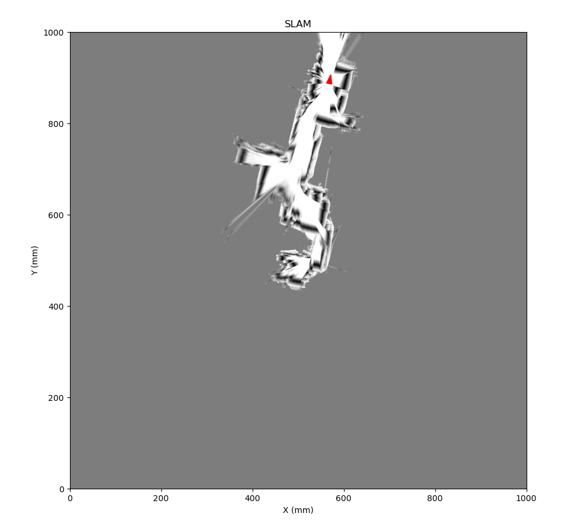 


